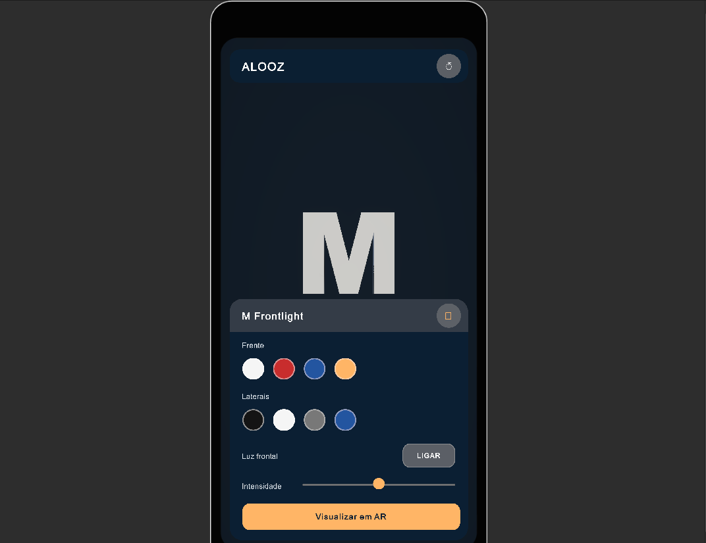
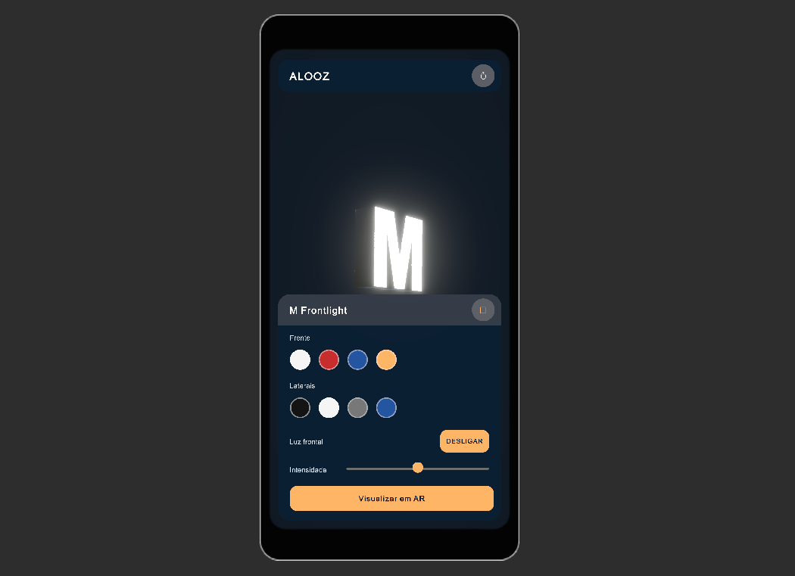
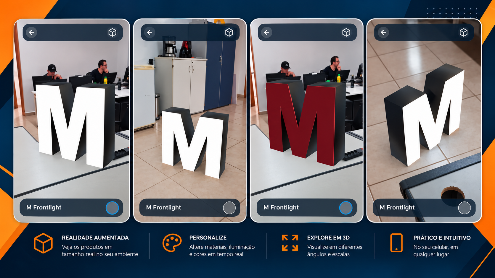

# Alooz AR Product Visualizer

<p align="center">
  <b>Interactive 3D and Augmented Reality product visualization built with Unity.</b>
</p>

<p align="center">
  A prototype that transforms physical product samples into an interactive 3D and AR experience.
</p>

---

## About the Project

**Alooz AR Product Visualizer** is an experimental application developed to explore a digital alternative to physical product demonstration samples.

In the traditional sales process, different product configurations may need to be demonstrated using physical samples. This prototype investigates how an interactive 3D catalog combined with Augmented Reality can make this experience more portable, visual and flexible.

The application currently provides two complementary visualization environments:

- **3D Studio** — configure and inspect the product in an interactive environment.
- **Augmented Reality** — place the configured product in the real world using a mobile device.

The current prototype uses an illuminated channel letter — **M Frontlight** — as the first product implementation.

---

## Project Location

This repository contains the complete Unity project, including Unity-generated project configuration and package dependencies.

The main source files and assets developed specifically for **Alooz AR Product Visualizer** are organized under:

```text
Assets/
└── _Alooz/
```

If you are exploring the repository, this is the main directory to start with.

```text
Assets/_Alooz/
├── Materials/
├── Models/
├── Prefabs/
├── Scenes/
├── Scripts/
└── UI/
```

### Main Development Areas

- **`Assets/_Alooz/Scenes/`** — Studio and Augmented Reality scenes
- **`Assets/_Alooz/Scripts/`** — C# application logic
- **`Assets/_Alooz/Models/`** — 3D product assets
- **`Assets/_Alooz/Materials/`** — product and visualization materials
- **`Assets/_Alooz/Prefabs/`** — reusable product prefabs
- **`Assets/_Alooz/UI/`** — UI Toolkit interfaces and styles

> **Start here:** `Assets/_Alooz/`

## Current Prototype

### M Frontlight

The first implemented product is a configurable front-lit channel letter.

The model was prepared in Blender and integrated into Unity as a configurable product with independent face and body materials.

<p align="center">
  
</p>

### 3D Studio

The Studio environment provides an interactive product visualization experience before entering AR.

Current features include:

- Interactive 3D product visualization
- Touch rotation
- Zoom and navigation
- Face color customization
- Body color customization
- Frontlight simulation
- Emission color synchronized with the face color
- Real-time material updates
- Transition from Studio to Augmented Reality

<p align="center">
  
</p>

---

## Augmented Reality

After configuring the product in the Studio, the same configuration can be visualized in the real environment.

The AR experience currently supports:

- ARCore tracking
- Horizontal surface detection
- Center-screen raycasting
- Reticle-based placement
- Real-world product placement
- AR Anchors
- Product repositioning
- Lock / edit placement workflow
- Runtime color customization
- Frontlight toggle
- Configuration persistence between Studio and AR
- UI Toolkit interface optimized for mobile devices

<p align="center">
  
</p>

---

## Studio → AR Workflow

The prototype maintains the product configuration while transitioning between visualization modes.

```text
Product
   │
   ▼
3D Studio
   │
   ├── Face Color
   ├── Body Color
   └── Frontlight
   │
   ▼
Product Session
   │
   ▼
Augmented Reality
   │
   ├── Surface Detection
   ├── Placement
   ├── AR Anchor
   └── Runtime Configuration
```

This allows the user to configure a product in the Studio and immediately visualize the same configuration in the physical environment.

---

## Technology Stack

| Technology | Purpose |
|---|---|
| Unity 6 | Application development |
| C# | Application logic |
| AR Foundation | Cross-platform AR framework |
| Google ARCore | Android tracking and environment understanding |
| Universal Render Pipeline | Rendering pipeline |
| UI Toolkit | Runtime user interface |
| Blender | 3D modeling and asset preparation |
| Android | Initial target platform |

---

## Project Structure

The project follows a simple separation between product visualization, AR interaction and interface logic.

```text
Assets/
└── _Alooz/
    ├── Materials/
    ├── Models/
    ├── Prefabs/
    ├── Scenes/
    ├── Scripts/
    │   ├── AR/
    │   ├── Studio/
    │   └── UI/
    └── UI/
        └── AR/
```

Main scenes:

```text
StudioScene
    │
    └── Interactive 3D visualization
            │
            ▼
       ProductSession
            │
            ▼
ARScene
    │
    └── Real-world visualization
```

---

## AR Placement Pipeline

The current AR placement flow is based on AR Foundation and ARCore.

```text
AR Camera
    │
    ▼
Plane Detection
    │
    ▼
Center Screen Raycast
    │
    ▼
Placement Reticle
    │
    ▼
User Touch
    │
    ▼
AR Anchor
    │
    ▼
3D Product
```

The anchor is used as the reference point for the virtual product after placement.

---

## Current Development Stage

This repository represents the first functional prototype of the project.

### Implemented

- [x] Unity mobile project
- [x] AR Foundation integration
- [x] Google ARCore integration
- [x] 3D Studio environment
- [x] M Frontlight 3D model
- [x] Runtime material customization
- [x] Frontlight simulation
- [x] Studio → AR configuration transfer
- [x] Plane detection
- [x] Reticle placement
- [x] AR Anchors
- [x] Mobile AR interface
- [x] Android prototype

### Next Steps

- [ ] Modular product architecture
- [ ] Multiple product support
- [ ] Product catalog
- [ ] Different placement strategies by product type
- [ ] Vertical surface placement
- [ ] Ground placement for large-scale products
- [ ] Improved AR stability
- [ ] Large-scale product visualization
- [ ] Support for products such as poles and large signage
- [ ] Improved Studio interaction
- [ ] Additional lighting configurations

---

## Modular Product Vision

The next development stage will transform the current single-product prototype into a modular visualization system.

The goal is to support products with very different characteristics and physical dimensions, ranging from small channel letters to large structures.

```text
Product Catalog
      │
      ▼
Selected Product
      │
      ├── 3D Model
      ├── Real Dimensions
      ├── Materials
      ├── Lighting
      └── Placement Rules
      │
      ├───────────────┐
      ▼               ▼
  3D Studio      Augmented Reality
```

Examples of future placement strategies include:

```text
Channel Letter
→ horizontal / vertical surfaces

Facade Sign
→ vertical surfaces

Totem
→ ground placement

15 m Pole
→ ground placement + large-scale visualization
```

---

## Why This Project?

Physical product samples are useful, but they have natural limitations regarding transportation, size and the number of configurations that can be demonstrated.

3D visualization and Augmented Reality create an opportunity to complement these samples with a digital experience where products can be:

- configured in real time;
- visualized from different angles;
- displayed with different materials and lighting;
- transported digitally;
- previewed directly in the customer's environment.

The project is being developed incrementally, starting with a single product and evolving toward a reusable product visualization platform.

---

## Platform

The current prototype targets:

**Android + Google ARCore**

Development and testing are currently focused on Android devices compatible with ARCore.

---

## Status

**Prototype / Work in Progress**

Current milestone:

`M Frontlight — Studio 3D + Augmented Reality`

---

## Author

**Tiago Augusto**

Computer Engineering  
3D • Augmented Reality • Software Development

---

## License

A license has not yet been defined for this repository.

All product models, brand assets and visual materials remain subject to their respective ownership and usage rights.